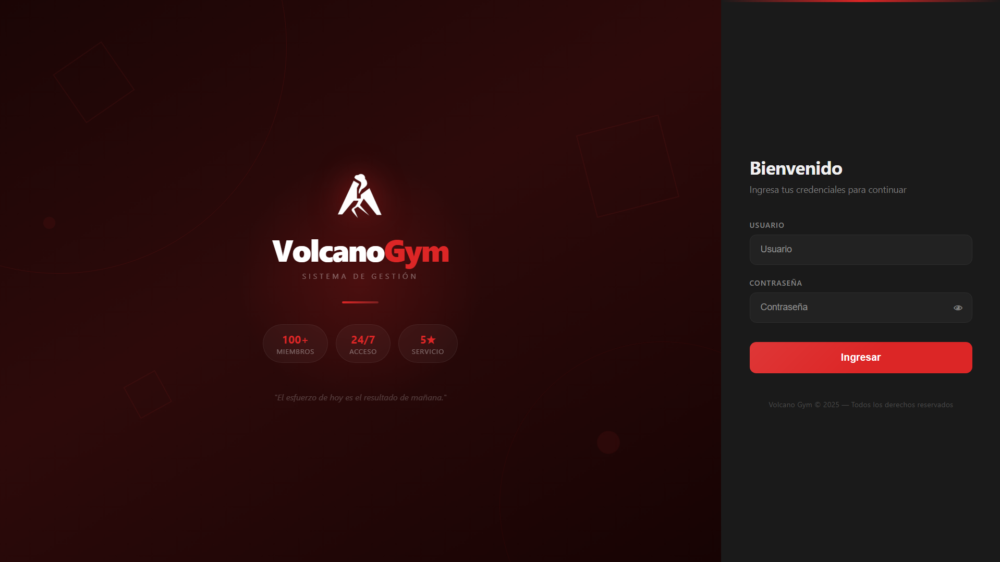
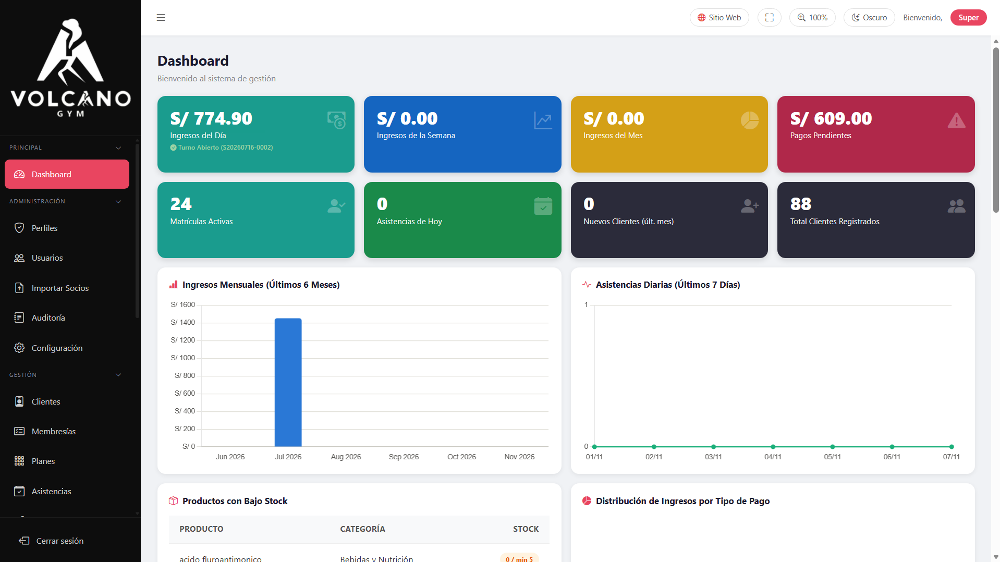
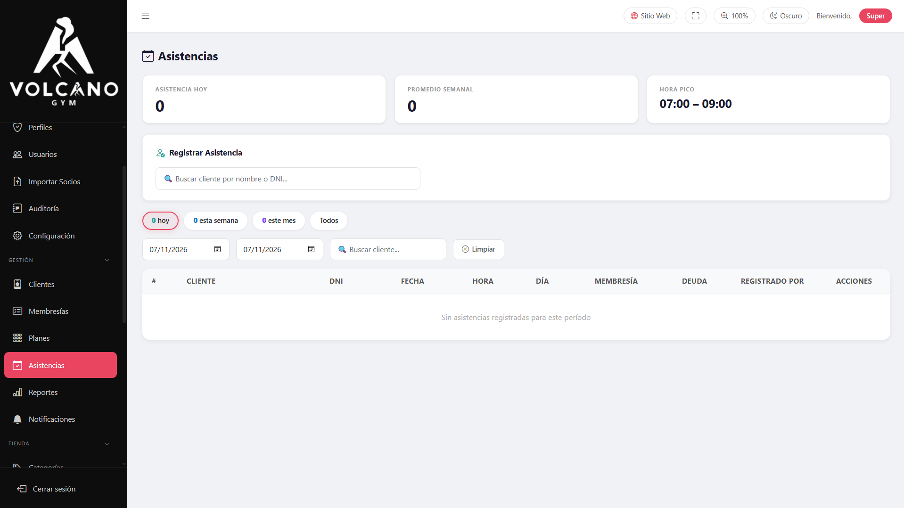
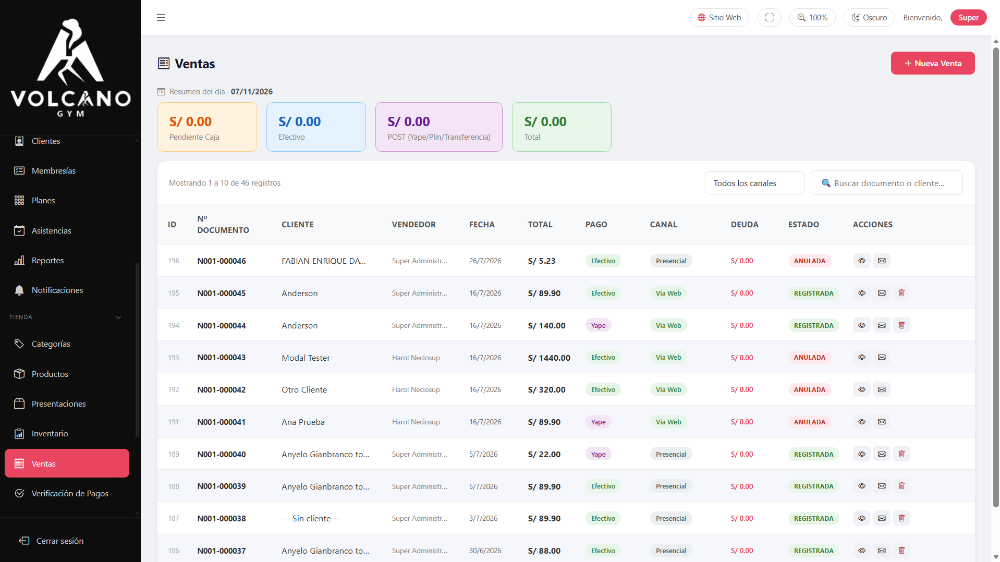

# VolcanoGym — Sistema Web de Gestión de Gimnasio y Control de Acceso

> **Sistema integral para la administración de gimnasios**: automatiza el control de membresías, valida el acceso de socios en tiempo real (por QR o DNI) y centraliza las ventas de mostrador, control de caja chica y emisión de comprobantes internos.

[](https://nodejs.org/)
[](https://expressjs.com/)
[](https://www.postgresql.org/)
[](https://developer.mozilla.org/)
[]()

---

## 🎯 El Problema que Resuelve
Anteriormente, el gimnasio gestionaba el control de asistencia y el vencimiento de pagos de forma manual (cuadernos y hojas de cálculo desactualizadas). Esto generaba:
* Ingreso de clientes con membresías vencidas o cuotas pendientes.
* Tiempos de espera lentos en recepción para registrar entradas o consultar deudas.
* Pérdida de trazabilidad en las ventas diarias y arqueos de caja.

**La solución:** VolcanoGym valida al instante si un cliente está al día o tiene deuda al escanear su código QR o ingresar su DNI en recepción, alertando al personal y automatizando el seguimiento de cobranzas.

---

## 🚀 Funcionalidades Principales

* 🆔 **Control de Asistencia Inteligente:** Validación en milisegundos mediante escáner QR o DNI; el sistema indica visualmente si la membresía está vigente, vencida o con cuotas pendientes al momento del ingreso.
* 📋 **Gestión Integral de Membresías:** Creación de planes flexibles, registro de inscripciones, control de cuotas, fechas límite y congelamientos temporales.
* 👤 **Registro Rápido de Clientes:** Autocompletado de datos personales consumiendo la **API de RENIEC** al digitar el número de DNI.
* 🛒 **Registro y Gestión de Ventas:** Control y trazabilidad de transacciones comerciales con registro de cliente, asesor/vendedor, fecha, canal de venta, métodos de pago (efectivo, transferencia o mixto) y emisión de comprobantes internos.
* 💵 **Gestión de Caja Chica:** Control de aperturas de turno, registro de ingresos/egresos rápidos y arqueo de cierre de caja para recepcionistas.
* 🔐 **Seguridad y Auditoría (RBAC):** Control de acceso basado en roles por base de datos (SuperAdmin, Administrador, Recepcionista, Vendedor) y registro de auditoría de cada operación.
* 📲 **Portal Web del Cliente:** Autoservicio donde el socio consulta su estado de cuenta, historial y su carnet digital con código QR dinámico.

---

## 📸 Capturas de Pantalla

| Inicio de Sesión | Panel de Control / Clientes |
| :---: | :---: |
|  |  |

| Validación de Asistencias (QR / DNI) | Registro y Control de Ventas |
| :---: | :---: |
|  |  |

---

## 🛠️ Tecnologías Utilizadas

* **Backend:** Node.js, Express 5, Socket.io (notificaciones en tiempo real), Node-Cron (tareas programadas).
* **Base de Datos:** PostgreSQL con Pool de conexiones (`pg`).
* **Frontend:** HTML5 semántico, CSS3 modular (con soporte Dark Mode y diseño responsive para móviles), JavaScript nativo (Vanilla ES6+).
* **Seguridad y Auth:** JWT (JSON Web Tokens), cookies HTTP-only, encriptación Bcryptjs y control de roles por base de datos.
* **Integraciones y Librerías:**
  * **API RENIEC** (Decolecta): Consulta y validación de identidad por documento.
  * **Nodemailer:** Envío automatizado de avisos por correo.
  * **SheetJS (xlsx):** Importación masiva de clientes desde archivos Excel.

---

## 🗄️ Estructura de la Base de Datos

El sistema cuenta con un esquema relacional normalizado en PostgreSQL con más de 20 tablas organizadas en módulos:

* **Gestión de Clientes y Acceso:** `cliente`, `membresia`, `pago`, `abono_cuota`, `asistencia`.
* **Catálogo y Almacén:** `producto`, `categoria`, `presentacion_producto`, `inventario`, `fotos_presentacion`.
* **Ventas y Tesorería:** `venta`, `detalle_venta`, `cuota_venta`, `cajas`, `sesiones_caja`, `movimientos_caja`.
* **Seguridad y Auditoría:** `usuarios`, `perfiles`, `opciones`, `permisos`, `auditoria`.

---

## 💻 Instalación y Ejecución Local

### Prerrequisitos
* [Node.js](https://nodejs.org/) (versión 18 o superior)
* [PostgreSQL](https://www.postgresql.org/) (versión 14 o superior)

### Pasos

1. **Clonar el repositorio:**
   ```bash
   git clone https://github.com/anyelolinarespe-commits/VolcanoGym.git
   cd VolcanoGym
   ```

2. **Instalar dependencias:**
   ```bash
   npm install
   ```

3. **Configurar variables de entorno:**
   Copia el archivo de ejemplo y completa tus credenciales locales:
   ```bash
   cp .env.example .env
   ```
   *Configuración básica requerida en `.env`:*
   ```env
   PORT=3000
   JWT_SECRET=tu_secreto_jwt
   DB_USER=postgres
   DB_HOST=localhost
   DB_NAME=Gym
   DB_PASSWORD=tu_password
   DB_PORT=5432
   ```

4. **Ejecutar en modo desarrollo:**
   ```bash
   npm run dev
   ```
   El servidor estará disponible en `http://localhost:3000`.

---

## 👥 Equipo y Colaboradores

Proyecto desarrollado como trabajo final para el curso **Proyecto Integrador 1** de la **Universidad Tecnológica del Perú (UTP)**:

* **Linares Carmen, Anyelo** ([@anyelolinarespe-commits](https://github.com/anyelolinarespe-commits)) — **Full Stack Developer**: Arquitectura del backend, modelado y diseño de base de datos PostgreSQL, controladores de negocio (membresías, asistencias, ventas), autenticación y diseño de interfaces.
* **Neciosup Fuentes, Harol Raul** ([@HarolNF](https://github.com/HarolNF)) — **Desarrollador Full Stack**: Desarrollo de módulos del sistema, lógica de negocio y consultas de base de datos.
* **Niño Antón, José Jefferson del Piero** ([@njosejefferson-crypto](https://github.com/njosejefferson-crypto)) — **Desarrollador Full Stack**: Desarrollo de vistas del sistema, módulos de verificación y soporte frontend/backend.

---

## 📌 Estado del Proyecto
* **Estado:** Proyecto académico finalizado.
* **Próximas mejoras (Roadmap):**
  * Despliegue en la nube (Docker + Railway / Render).
  * Integración real con API de facturación electrónica (SUNAT).
  * Pasarela de pagos online integrada en el portal web (Culqi / Stripe).
  * Módulo de reportes avanzados con gráficos interactivos de retención de socios.
